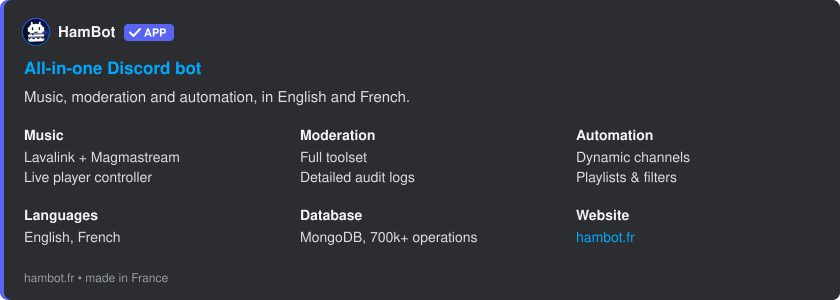
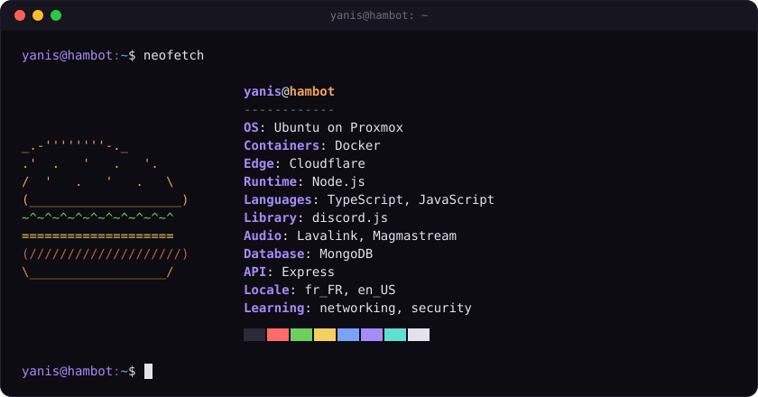

I'm Yanis, a developer from France. I spend most of my time on HamBot, a Discord bot I build and host myself, and the rest learning networking and security on my own servers.

### HamBot

Lately it's mostly performance work: getting more out of Discord.js, caching so MongoDB doesn't take every hit, and monitoring so I see problems before users do.

### Setup

### Contact

Bot questions or bug reports: [support@hambot.fr](mailto:support@hambot.fr)
